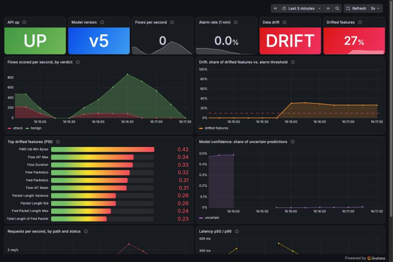
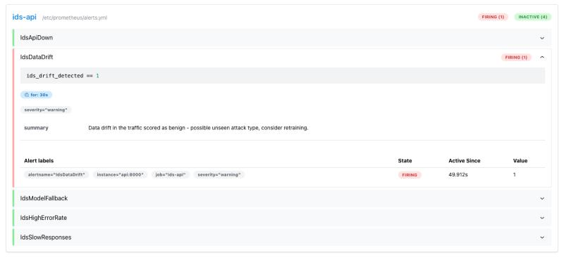
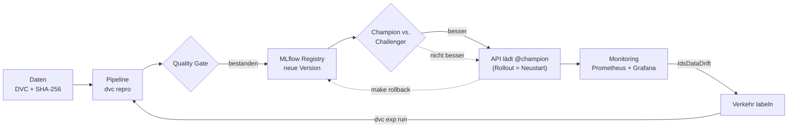
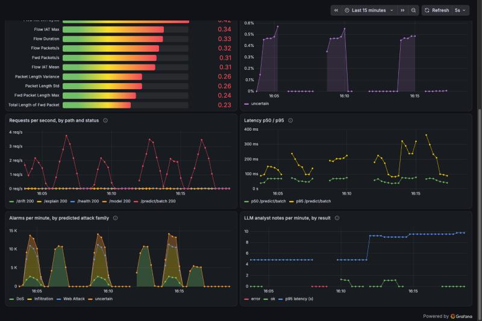
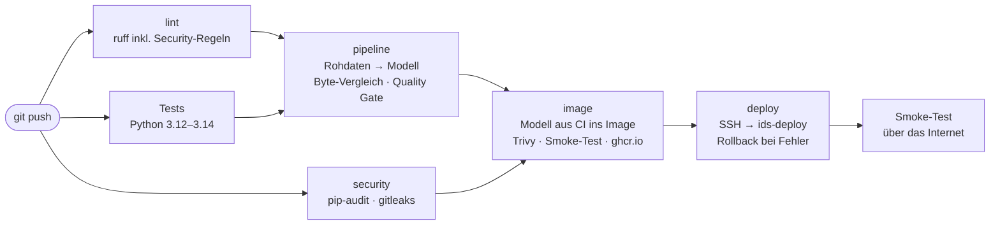
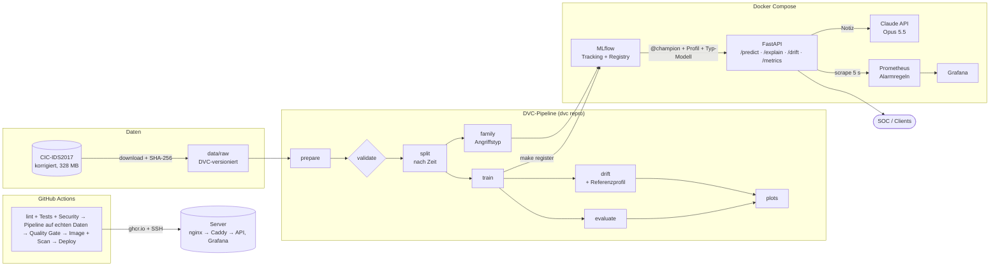

# Intrusion Detection MLOps

[](https://github.com/Maik-Huebner/intrusion-detection-mlops/actions/workflows/ci.yml)
[](https://ids.178-104-83-110.sslip.io/docs)


> **TL;DR (English).** An end-to-end MLOps system that detects network attacks in flow data
> (corrected CIC-IDS2017, 2.1 M flows) – and notices when it goes stale. A model that is perfect on
> Monday–Wednesday catches **0 %** of Thursday's new attacks and stays silent: no alarms, hardly any uncertainty.
> A label-free drift monitor on the traffic the model lets through fires anyway. Retraining with
> Thursday as a DVC experiment, champion/challenger promotion in the MLflow registry and a rollout
> without rebuilding the image bring Friday's never-seen attacks from **37 %** to **99 %**. A second model
> names the attack type, and Claude writes a rule-checked note for the analyst – including a warning when
> the drift monitor says the type may be wrong.
> Locally everything runs in one `docker compose` stack (MLflow, FastAPI, Prometheus, Grafana). Every push
> to `main` is linted, tested, security-scanned, rebuilt from the raw data (byte-identical results),
> quality-gated, packed into an image and **deployed automatically** to a public server – with automatic
> rollback if the new version is unhealthy: **[live API](https://ids.178-104-83-110.sslip.io/docs)** ·
> **[live dashboard](https://ids.178-104-83-110.sslip.io/grafana/)**.

Ein Machine-Learning-Modell erkennt im Netzwerkverkehr, ob eine Verbindung normal ist oder zu einem
Angriff gehört (DoS, Brute Force, PortScan, Botnet, Web-Angriffe …). Im Mittelpunkt steht aber nicht
das Modell, sondern der **Kreislauf drumherum**: Daten versionieren und prüfen, reproduzierbar
trainieren, nur geprüfte Modelle ausrollen, im Betrieb merken, dass das Modell veraltet, neu trainieren
und das neue Modell kontrolliert ausrollen.

**Live:** [Startseite zum Ausprobieren](https://ids.178-104-83-110.sslip.io/) ·
[API mit interaktiver Doku](https://ids.178-104-83-110.sslip.io/docs) ·
[Grafana-Dashboard](https://ids.178-104-83-110.sslip.io/grafana/) · [welcher Commit läuft?](https://ids.178-104-83-110.sslip.io/model)

**Inhalt:** [Die Geschichte in drei Bildern](#die-geschichte-in-drei-bildern) ·
[Der MLOps-Kreislauf](#der-mlops-kreislauf) · [Monitoring ohne Labels](#monitoring-ohne-labels) ·
[Angriffstyp und LLM-Notiz](#welcher-angriff-angriffstyp-und-llm-notiz) ·
[CI/CD](#cicd-vom-push-in-den-betrieb) · [Sicherheit](#sicherheit) ·
[Architektur](#architektur) · [Datensatz](#der-datensatz-und-warum-die-korrigierte-fassung) ·
[Schnellstart](#schnellstart) · [Live-Demo](#live-demo-in-drei-befehlen) ·
[Erkenntnisse](#erkenntnisse-aus-dem-projekt) · [Grenzen](#grenzen-und-nächste-schritte)

## Die Geschichte in drei Bildern

### 1. Offline perfekt, im Einsatz blind

Ein Modell, trainiert mit dem Verkehr von **Montag bis Mittwoch**, trifft auf **Donnerstag und Freitag**:


| | Erkennungsrate | Fehlalarme |
|---|---:|---:|
| Bekannte Angriffsarten (Testdaten Mo–Mi) | **100,0 %** (35.714 von 35.715) | 0 |
| Donnerstag (Infiltration, Web-Angriffe) | **0,0 %** (0 von 71.902) | 2 von 290.018 |
| Freitag (PortScan, DDoS, Botnet) | **37,3 %** – fast nur DDoS | 1 von 292.506 |

Das ist **Concept Drift**: Angreifer benutzen neue Methoden, und das Modell hat sie nie gesehen.
Gefährlich daran ist nicht die schlechte Zahl, sondern dass sie im Betrieb **niemand sieht**. Die echten
Labels kennt ein SOC erst Tage später, wenn Analysten die Vorfälle bestätigt haben.

### 2. Das Modell schweigt, die Daten nicht

Am Donnerstag gibt das Modell **null Treffer** aus, und es ist sich dabei fast völlig sicher: Nur 8 von
361.920 Vorhersagen liegen zwischen 10 % und 90 %. Wer nur auf die Ausgabe des Modells schaut, sieht einen ruhigen
Tag. Der Drift-Monitor vergleicht deshalb die **Eingabedaten**, genauer die Flows, die das Modell als
harmlos durchlässt, mit dem normalen Trainingsverkehr. Er braucht dafür keine Labels:


| Verkehr, den das Modell durchlässt | Merkmale mit Drift (PSI > 0,2) | Alarm |
|---|---:|:---:|
| Testdaten Mo–Mi | 0 von 83 (0 %) | – |
| Donnerstag | 24 von 83 (29 %) | **ja** |
| Freitag | 39 von 83 (47 %) | **ja** |
| Freitag, nach dem Retraining (Modell Mo–Do) | 0 von 83 (0 %) | – |

### 3. Der Kreislauf schließt sich – live gemessen

Die Live-Demo spielt echten Verkehr gegen die laufende API ab. Prometheus misst, Grafana zeigt an:


1. **Mittwoch** mit Modell v5 (Mo–Mi): DoS-Angriffe werden zu 100 % erkannt, kein Drift.
2. **Donnerstag:** 0 von 6.124 Angriffen erkannt, alles „grün“. Der Drift-Monitor springt auf 30 %,
   Prometheus löst den Alarm `IdsDataDrift` aus.
3. **Analysten-Notiz** für einen DDoS-Flow vom Freitag: Das Typ-Modell nennt ihn „DoS Hulk“ – zu 99,9 %
   sicher und falsch. Die LLM-Notiz schreibt: *„Achtung, Drift: Die Zuordnung des Angriffstyps kann falsch
   sein, da der Drift-Monitor eine Warnung auslöst.“*
4. **Retraining** mit den gelabelten Donnerstagsdaten (DVC-Experiment), **Champion/Challenger** in der
   MLflow-Registry: v6 schlägt v5 auf den aktuellen Daten (F1 0,9986 gegen 0,8963) und wird `@champion`.
   **Rollout** durch Neustart der API, ohne neues Image.
5. **Freitag** mit v6, Angriffe, die auch v6 nie gesehen hat: **99,1 %** erkannt (vorher 37,3 %),
   PortScan 99,2 %, DDoS 99,9 %, Fehlalarmrate 0,19 %.

| Grafana im Moment des Alarms | Prometheus-Alarm |
|---|---|
|  |  |

## Warum MLOps gerade in der Cybersecurity?

Angreifer ändern ständig ihre Methoden. Ein Modell, das heute fast alle Angriffe findet, kann morgen
blind für eine neue Angriffsart sein, ohne dass sich an seinem Code etwas ändert. Ein einmal trainiertes
Modell reicht deshalb nicht. Man braucht ein System, das **merkt**, wenn sich der Verkehr verändert,
neue Daten aufnimmt und prüft, neu trainiert, das neue Modell gegen das alte vergleicht und es nur dann
ausrollt, wenn es wirklich besser ist – mit einem Weg zurück, falls doch etwas schiefgeht.

## Der MLOps-Kreislauf



| Schritt | Befehl | Was passiert |
|---|---|---|
| Trainieren | `make pipeline` | DVC rechnet nur die Stufen neu, deren Eingaben sich geändert haben |
| Registrieren | `make register` | Run mit Parametern, Metriken, Berichten, Daten-Hash und Git-Commit; neue Modellversion; Champion/Challenger-Entscheidung |
| Ausrollen | `make rollout` | API neu starten, sie lädt `models:/ids-detector@champion` samt Drift-Profil |
| Beobachten | Grafana, Prometheus | goldene Signale, Alarmrate, Drift, Modellversion; Alarmregeln |
| Neu trainieren | `make retrain` | DVC-Experiment mit Donnerstag im Training, danach Registrierung und Promotion |
| Zurückrollen | `make rollback V=3` | `@champion` zeigt wieder auf Version 3, die API lädt sie |

Der Champion/Challenger-Vergleich ([`registry.py`](src/ids/registry.py)) misst **beide Modelle auf
denselben, neuesten gelabelten Daten**. Die eigene Testmetrik des alten Champions sagt nach einem Drift
nichts mehr über den heutigen Verkehr aus. Ein Challenger muss zusätzlich das Quality Gate bestehen und
den Champion um mindestens 0,005 F1 schlagen.

## Monitoring ohne Labels

### Warum nicht einfach die Alarmrate überwachen?

Weil das Modell bei einer unbekannten Angriffsart **selbstsicher falsch** liegt. Am Donnerstag sinkt die
Alarmrate sogar auf praktisch 0 (2 Fehlalarme) – das sieht aus wie ein ruhiger Tag. Auch die Unsicherheit
bleibt bei praktisch 0 (8 von 361.920 Flows zwischen 10 % und 90 %). Signale aus der Modellausgabe helfen hier nicht.

### Was stattdessen überwacht wird

[`ids/drift.py`](src/ids/drift.py) berechnet für jedes der 83 Merkmale den
**Population Stability Index (PSI)**:

1. Beim Training entsteht ein **Referenzprofil** des normalen Verkehrs: je Merkmal zehn Quantil-Intervalle
   und der Anteil der Trainings-Flows darin. Das Profil gehört zur Modellversion, wird in MLflow mit dem
   Modell gespeichert und mit ihm ausgerollt.
2. Die API sammelt die letzten 1.000 Flows, die das Modell als harmlos durchlässt, und vergleicht ihre
   Verteilung mit dem Profil: `PSI = Σ (neu − ref) · ln(neu / ref)`.
3. Hat mehr als 10 % der Merkmale einen PSI über 0,2, gilt der Verkehr als gedriftet.

**Warum nur die durchgelassenen Flows?** Erkannte Angriffe sind schon Alarme. Gefährlich ist der Angriff,
der für das Modell harmlos aussieht – er verändert, wie „harmloser“ Verkehr aussieht. Normaler Verkehr
bleibt dagegen bei 0 % Drift, egal wie viele bekannte Angriffe gerade laufen. In den Daten geprüft: Der
normale Verkehr von Donnerstag und Freitag zeigt allein **0 % Drift**, auch in jedem 1.000er-Fenster. Der
Alarm kommt also von den Angriffen, nicht von einem anderen Wochentag.

Dieselbe Funktion läuft **offline** in der DVC-Stufe `drift` (Ergebnis: [`reports/drift.json`](reports/drift.json))
und **online** in der API (Metriken `ids_drift_share`, `ids_feature_psi`).

### Metriken und Alarme

| Metrik (`/metrics`) | Bedeutung |
|---|---|
| `ids_http_requests_total`, `ids_http_request_duration_seconds` | goldene Signale: Verkehr, Fehler, Latenz |
| `ids_flows_scored_total{verdict}` | bewertete Flows, harmlos oder Angriff → Alarmrate |
| `ids_attack_probability` | Verteilung der Angriffswahrscheinlichkeit → Unsicherheit |
| `ids_drift_share`, `ids_drift_detected`, `ids_feature_psi{feature}` | Drift-Monitor |
| `ids_model_info{version, source, fallback}` | welche Modellversion gerade ausgeliefert wird |
| `ids_alarms_by_family_total{family}` | Alarme nach vorhergesagter Angriffsfamilie |
| `ids_llm_requests_total{result}`, `ids_llm_latency_seconds`, `ids_llm_tokens_total` | LLM-Notizen: ok, rejected, error |

| Alarm ([`alerts.yml`](monitoring/alerts.yml)) | Bedingung |
|---|---|
| `IdsDataDrift` | Drift im durchgelassenen Verkehr seit 30 s – mögliche neue Angriffsart |
| `IdsApiDown` | Prometheus erreicht die API nicht |
| `IdsModelFallback` | Registry beim Start nicht erreichbar, die API nutzt ihr eingebautes Modell |
| `IdsLlmFallback` | Notizen kamen in den letzten 5 Minuten aus der Vorlage (LLM-Fehler oder Regelverstoß) |
| `IdsHighErrorRate` | mehr als 5 % Serverfehler |
| `IdsSlowResponses` | p95-Latenz von `/predict` über 250 ms |

### Evaluation der laufenden API

[`ids.evaluate_api`](src/ids/evaluate_api.py) testet die API so, wie ein Client sie benutzt, und
schreibt das Ergebnis nach MLflow (Experiment `ids-api-evaluation`):

| Prüfung | Ergebnis (Modell Mo–Do, lokal auf einem M4 Pro) |
|---|---|
| Qualität über HTTP (20.000 Test-Flows) | Erkennungsrate 99,7 %, Fehlalarmrate 0,0 % |
| Latenz `/predict` | p50 6 ms · p95 41 ms · p99 63 ms |
| Durchsatz `/predict/batch` | 13.600 Flows pro Sekunde |
| Robustheit | 6 von 6 ungültigen Anfragen mit 422 abgelehnt, kein Absturz |

## Welcher Angriff? Angriffstyp und LLM-Notiz

Der Detektor sagt nur „Angriff oder nicht“. Für einen Analysten ist die nächste Frage: **welcher?**

**Ein zweites Modell** (DVC-Stufe `family`, [`family.py`](src/ids/pipeline/family.py)) lernt auf den
Angriffs-Flows der Trainingstage den Angriffstyp, z. B. `SSH-Patator` oder `DoS Hulk`, und daraus die
Familie. Auf bekannten Angriffen liegt es zu **99,99 %** richtig. Es kann aber nur Typen nennen, die es
kennt – und ordnet neue Angriffe **selbstsicher einer bekannten Familie** zu
([`reports/family.json`](reports/family.json)):

| Unbekannte Angriffsart (Modell Mo–Mi) | So nennt sie das Typ-Modell |
|---|---|
| PortScan | 98,8 % „DoS“ |
| DDoS | 100 % „DoS“ |
| Web-Angriffe | 84,6 % „Heartbleed“ |
| Infiltration | 97,9 % „DoS“ |

Eine Schwelle für die Sicherheit (unter 90 % → `uncertain`) fängt nur 1–10 % davon ab. Deshalb gehört
der Drift-Monitor in die Notiz.

**Die LLM-Notiz** (`POST /explain`, [`api/llm.py`](src/ids/api/llm.py)): **Claude Opus 5.5** (Anthropic-SDK,
niedriger Effort, serverseitiger Fallback bei einer Ablehnung durch die Sicherheitsfilter) bekommt
**nur die Ergebnisse der Modelle** – Typ, Familie,
Wahrscheinlichkeiten, die Merkmale, die am weitesten außerhalb des normalen Verkehrs liegen, und den
Zustand des Drift-Monitors – und schreibt daraus drei Sätze für den Analysten. Das LLM entscheidet nicht,
was der Angriff ist; es formuliert.

```json
{
  "prediction": {"is_attack": true, "attack_type": "DoS Hulk", "family": "DoS", "type_confidence": 0.9993},
  "drift_warning": true,
  "note": "… als DoS Hulk (Familie DoS) eingestuft … Achtung, Drift: Die Zuordnung des Angriffstyps kann falsch sein, da der Drift-Monitor eine Warnung auslöst.",
  "source": "llm",
  "rules": {"names_attack_type": true, "no_other_attack_family": true, "no_invented_identifiers": true,
            "drift_only_when_warned": true, "no_preamble": true, "short": true}
}
```

Jede Notiz muss **sieben Regeln** bestehen: den erkannten Typ nennen, keine andere Angriffsfamilie
erwähnen, keine IP-Adressen, CVE-Nummern oder URLs erfinden, „Drift“ genau dann erwähnen, wenn der
Monitor warnt, ohne Einleitung, höchstens 90 Wörter, reiner Text ohne HTML, Markdown oder Links. Bricht sie eine Regel, ist das LLM zu langsam oder
nicht erreichbar, kommt eine **Notiz aus einer Vorlage** – die API scheitert nie am LLM. Prometheus
zählt jedes Ergebnis (`ids_llm_requests_total{result}`), der Alarm `IdsLlmFallback` meldet Ausfälle.

**KI-Sicherheit:** Prompt-Injection ist hier schon durch den Aufbau ausgeschlossen. Die API nimmt
nur 83 Zahlen an (unbekannte Felder und Text → 422), der Prompt besteht nur aus Ergebnissen der eigenen
Modelle, die vor jedem Aufruf gegen Allowlists geprüft werden, und das LLM hat keine Werkzeuge und
entscheidet nichts. Seine Ausgabe gilt als nicht vertrauenswürdig: Steuer- und unsichtbare
Unicode-Zeichen werden entfernt, HTML, Markdown und Links abgelehnt, die Startseite zeigt sie nur als
Text an. Die vollständige Prüfung entlang der OWASP Top 10 für LLM-Anwendungen steht in
[`SECURITY.md`](SECURITY.md#ki-sicherheit-owasp-top-10-für-llm-anwendungen-2025).

**Kosten im Griff:** Der Endpunkt ist öffentlich. Ein Budget in der API erlaubt höchstens 10 Claude-Notizen
pro Minute und 300 pro Tag (`LLM_MAX_PER_MINUTE`, `LLM_MAX_PER_DAY`); darüber schreibt die API die
Vorlage (`reason: "budget"`). Der API-Key liegt nur in `secrets.env` (lokal) bzw. auf dem Server, nie im
Repository oder Image. Ohne Key oder offline funktioniert alles mit der Vorlage – oder mit einem lokalen
LLM: `LLM_PROVIDER=openai` und `make llm` (Ollama, `llama3.2:3b`).

**Prompts und LLMs werden gemessen wie Modelle** ([`ids.evaluate_llm`](src/ids/evaluate_llm.py),
MLflow-Experiment `ids-llm-evaluation`, 26 Angriffs-Flows aller bekannten Typen):

| LLM | Prompt | Regeln bestanden | häufigster Verstoß | Latenz p50 / p95 |
|---|---|---:|---|---|
| llama3.2:3b (lokal) | v1 | **0 %** | Einleitung „Hier ist die Notiz …“ (26×), „Drift“ ohne Warnung (21×) | 5,1 s / 9,0 s |
| llama3.2:3b (lokal) | v2 | **92 %** | 1× Typ nicht genannt, 1× Timeout → Vorlage | 4,4 s / 8,6 s |
| Claude Opus 5.5 | v2 | **77 %** | 6× zu lang (84–89 Wörter bei Grenze 90), sonst alles richtig | 3,1 s / 4,3 s |
| Claude Opus 5.5 | **v3** | **100 %** | – (auch mit der siebten Regel „kein Markup“) | 2,4 s / 3,7 s |

Das kleine lokale Modell hat das Wort „Drift“ aus dem Systemprompt einfach nachgeplappert. Claude hält
sich an alle Fakten, schreibt aber lange Sätze – v3 setzt deshalb eine Grenze von 60 Wörtern und erreicht
26 von 26. Jeder Prompt ist eine Version im Code (`LLM_PROMPT_VERSION`) und ein Run in MLflow. In v2 steht die
Drift-Anweisung nur noch im Prompt, wenn der Monitor wirklich warnt, und eine Bereinigung im Code
entfernt Einleitungen. Mit `LLM_PROMPT_VERSION=v1` lässt sich der alte Prompt jederzeit wieder messen.



## CI/CD: vom Push in den Betrieb

Jeder Push auf `main` durchläuft dieselbe Kette – und landet nur dann im Betrieb, wenn jeder Schritt grün
ist ([`ci.yml`](.github/workflows/ci.yml)):



- **Das Modell im Betrieb ist das Modell aus CI.** Der Job `pipeline` baut es aus den Rohdaten neu,
  prüft die Ergebnisse Byte für Byte gegen den Commit und lässt es durch das Quality Gate. Der Job `image`
  packt genau diese Dateien ins Image und taggt es mit dem Commit (`ghcr.io/maik-huebner/intrusion-detection-mlops:<sha>`).
  Retraining als Git-Workflow: Wer `params.yaml` ändert (z. B. Donnerstag ins Training), bekommt nach dem
  Merge automatisch ein neues, geprüftes Modell in den Betrieb.
- **Deployment ohne Shell-Zugang:** Der SSH-Schlüssel in GitHub darf auf dem Server nur ein Skript
  ausführen ([`deploy/ids-deploy`](deploy/ids-deploy), forced command), und das akzeptiert nur
  `deploy <Commit auf main>`. Es holt das Image, startet den Stack neu und wartet, bis `/model` die neue
  Revision meldet. Wird die neue Version nicht gesund, **startet es automatisch die vorherige wieder**.
- **Nachweis über das Internet:** Der letzte Schritt ruft `https://…/model` auf und prüft, dass genau der
  gepushte Commit antwortet, und dass `/metrics` von außen nicht erreichbar ist.

Der Stack auf dem Server ([`deploy/compose.prod.yaml`](deploy/compose.prod.yaml)) teilt sich die Maschine
mit anderen Seiten und ist entsprechend eng geschnitten:

| Dienst | öffentlich | Härtung |
|---|---|---|
| nginx (Host) | TLS, Ratenlimit 20 Anfragen/s je IP, 12 MB je Anfrage | – |
| Caddy | leitet `/` zur API, `/grafana/` zum Dashboard, `/metrics` → 404, Sicherheits-Header | Nicht-Root, schreibgeschützt |
| API | `/docs`, `/predict`, `/explain`, `/drift`, `/model` | Nicht-Root, schreibgeschützt, keine Capabilities, 1 GB / 1 CPU |
| Prometheus | nein | Netz ohne Internetzugang |
| Grafana | nur lesend (anonym), Login abgeschaltet | Netz ohne Internetzugang, zufälliges Admin-Passwort |

Welche Version läuft, zeigt `GET /model` (`revision` = Commit) und die Grafana-Kachel „Model version“
(`CI <commit>` auf dem Server, `v<Version>` mit der Registry lokal).

**Ende-zu-Ende geprüft (26.11.2026):**

| Prüfung | Ergebnis |
|---|---|
| Push bis „läuft öffentlich“ | **9 min 38 s** (Commit `bf07245`: Tests, Pipeline, Gate, Image, Scan, Deploy, Smoke-Test) |
| Rollback | Deployment eines Commits ohne Image → Skript meldet Fehler, vorherige Version läuft weiter |
| Drift über das Internet | Replay Mittwoch: 100 % erkannt, kein Drift · Donnerstag: 0 % erkannt, **Drift 31 %**, im öffentlichen Dashboard sichtbar |
| Härtung | HTTP → HTTPS, `/metrics` 404, Grafana-Login abgelehnt, `NaN` → 422, Ratenlimit (429 ab ~20 Anfragen/s) |
| Deploy-Schlüssel | beliebiger Befehl, `;`-Anhang und Port-Weiterleitung abgelehnt |
| Speicher auf dem Server | API 285 MB, Grafana 310 MB, Prometheus 70 MB, Proxy 50 MB (alle mit Limit) |

## Sicherheit

Das Projekt wurde vor dem öffentlichen Deployment auf Schwachstellen geprüft; Befunde, Maßnahmen und
bewusst akzeptierte Risiken stehen in [`SECURITY.md`](SECURITY.md). Die wichtigsten Punkte:

- **Gefunden und behoben:** Flows mit `NaN`/`Infinity` führten zu HTTP 500 (jetzt 422 ohne Echo der
  Eingabe); ein öffentlicher `/explain` hätte beliebig viele kostenpflichtige LLM-Aufrufe erlaubt (jetzt
  Budget); Grafanas Standard-Login wäre im Internet offen gewesen (jetzt abgeschaltet).
- **Bei jedem Push geprüft:** bekannte Schwachstellen aller Pakete (`pip-audit`), unsichere Code-Muster
  (Ruff-Regeln `S`), Geheimnisse in der gesamten Git-Historie (`gitleaks`), Schwachstellen im Image
  (Trivy, blockiert das Deployment), alle Actions auf Commit-SHAs fixiert, Dependabot.
- **Geheimnisse:** Der Claude-Key liegt nur in `secrets.env` bzw. auf dem Server (Rechte 600); der
  Deploy-Schlüssel kann keine Shell öffnen; GHCR nutzt das kurzlebige Token des Workflows.

## Architektur



| Baustein | Werkzeug | Was es hier leistet |
|---|---|---|
| Umgebung | **uv** + `uv.lock` | exakt gleiche Paketversionen lokal, in CI und im Docker-Image |
| Daten versionieren | **DVC** | Rohdaten und jeder Zwischenstand haben einen Hash; `dvc.lock` hält fest, welcher Datenstand welches Modell erzeugt hat |
| Datenqualität | `ids.pipeline.validate` | Schema, Wertebereiche, Labels; eine Verletzung stoppt die Pipeline |
| Pipeline & Experimente | **DVC** | 8 Stufen, nur Geändertes wird neu gerechnet; Retraining als `dvc exp run` |
| Tracking & Registry | **MLflow** | Runs mit Lineage (Daten-Hash, Git-Commit); Champion/Challenger, Rollback; Modelle als skops statt pickle |
| Quality Gate | `ids.quality_gate` | Erkennungsrate ≥ 98 %, Fehlalarmrate ≤ 0,5 %, F1 ≥ 0,98 – sonst keine Freigabe |
| Serving | **FastAPI** + **Docker** | Validierung jedes Merkmals, Modell aus der Registry mit Rückfall auf das eingebaute Modell, Nicht-Root-Container |
| Angriffstyp | zweites Modell (`family`) | Typ und Familie für jeden Alarm, „uncertain“ unter 90 % Sicherheit |
| LLM-Notiz | **Claude** (Anthropic-SDK), optional Ollama | Notiz für Analysten aus den Modell-Ergebnissen, sieben Regeln, Schutz vor Prompt-Injection, Vorlage als Rückfall, Budget, Prompt- und LLM-Evaluation in MLflow |
| Monitoring | **Prometheus** + **Grafana** | goldene Signale, Alarmrate, Drift ohne Labels, Alarme nach Familie, LLM-Ergebnisse, sechs Alarmregeln |
| CI/CD | **GitHub Actions** + GHCR | Lint, Tests auf drei Python-Versionen, Sicherheitsprüfungen, komplette Pipeline auf den echten Daten, Byte-Vergleich, Quality Gate, Image mit Schwachstellen-Scan, automatisches Deployment mit Rollback |
| Betrieb | **nginx** + **Caddy** auf einem Server | TLS (Let's Encrypt), Ratenlimit, gehärtete Container, öffentliche API und Dashboard, interne Metriken |

## Der Datensatz und warum die korrigierte Fassung

[CIC-IDS2017](https://www.unb.ca/cic/datasets/ids-2017.html) (Canadian Institute for Cybersecurity) ist
einer der meistgenutzten Benchmarks für Intrusion Detection: fünf Tage Netzwerkverkehr (3.–7. Juli 2017)
mit eingeschleusten Angriffen, aufbereitet als Flows mit über 80 Merkmalen.

Das Original hat **bekannte, schwerwiegende Fehler**: falsch gelabelte Angriffe, Fehler im
Feature-Extraktor CICFlowMeter, fehlerhaft zusammengesetzte Flows. Engelen et al. (2021) zeigen, dass
über 20 % der Flows neu erzeugt oder umgelabelt werden müssen. Viele Paper mit „99,9 % Genauigkeit“
messen deshalb teilweise Artefakte statt Angriffe.

Dieses Projekt nutzt die **korrigierte Fassung von Liu, Engelen et al. (IEEE CNS 2022)**, neu erzeugt aus
den Original-PCAPs:

| Tag | Flows | davon Angriffe | Angriffsarten |
|---|---:|---:|---|
| Montag | 371.516 | 0 | nur normaler Verkehr |
| Dienstag | 321.963 | 6.933 | FTP-Patator, SSH-Patator (Brute Force) |
| Mittwoch | 496.527 | 171.642 | DoS Hulk, GoldenEye, Slowloris, Slowhttptest, Heartbleed |
| Donnerstag | 361.920 | 71.902 | Infiltration (mit Portscan aus dem Netz heraus), Web-Angriffe (Brute Force, XSS, SQL Injection) |
| Freitag | 547.452 | 254.946 | PortScan, DDoS, Botnet |

**Bewusste Entscheidungen in der Datenaufbereitung** (Details in [`prepare.py`](src/ids/pipeline/prepare.py)):

1. **„Attempted“-Flows werden normal.** 11.979 Flows gehören zu einem Angriffsskript, enthalten aber
   nichts Bösartiges (z. B. antwortet das Ziel nicht). Die Autoren empfehlen, sie als BENIGN zu werten.
2. **IP-Adressen, Ports der Quelle, Flow-ID und Zeitstempel fliegen raus.** Sonst lernt das Modell
   „172.16.0.1 greift an“ statt „so sieht ein Angriff aus“. Im echten Netz nützt das nichts.
3. **16-Bit-Überlauf in CICFlowMeter.** Die Validierung schlug beim ersten Lauf an: 593 Flows haben eine
   negative Header-Länge, alle zwischen −32.768 und 32.767. Lange Flows laufen in einem 16-Bit-Zähler über.
   Der echte Wert ist nicht rekonstruierbar, die Zeilen (0,03 %) werden entfernt.
4. **Duplikate vor dem Split entfernen** (82.303 Flows). Sonst steht dieselbe Verbindung in Training und
   Test, und das Ergebnis sieht besser aus, als es ist.
5. **Split nach Zeit, nicht zufällig.** Ein Modell im Einsatz kennt nur die Vergangenheit.

## Schnellstart

Voraussetzungen: [uv](https://docs.astral.sh/uv/), Docker, ca. 6 GB freier Speicher.

```bash
git clone https://github.com/Maik-Huebner/intrusion-detection-mlops.git
cd intrusion-detection-mlops
uv sync                              # Umgebung exakt nach uv.lock
make data                            # 328 MB, mit SHA-256-Prüfung
make pipeline                        # komplette Pipeline, ca. 1 Minute auf einem M4 Pro
uv run dvc metrics show              # Ergebnisse
make check                           # Lint und 110 Tests
```

### Den Stack starten

```bash
# optional, für Claude-Notizen (sonst Vorlage): Key unsichtbar eingeben, landet nur in secrets.env
umask 077 && read -rs "k?ANTHROPIC_API_KEY: " && printf 'ANTHROPIC_API_KEY=%s\n' "$k" > secrets.env && unset k
make stack                           # MLflow, API, Prometheus, Grafana
make register                        # Modell (Mo–Mi) in die Registry, wird @champion
make rollout                         # API lädt den Champion
```

(`read -rs "k?…"` ist zsh, in bash: `read -rsp "ANTHROPIC_API_KEY: " k`.)

| Dienst | Adresse |
|---|---|
| API mit interaktiver Doku | http://localhost:8000/docs |
| MLflow (Runs, Registry) | http://localhost:5050 |
| Prometheus (Alarme) | http://localhost:9090/alerts |
| Grafana (Dashboard) | http://localhost:3000 (Port über `GRAFANA_PORT` in `local.env`, hier 3001) |

| Endpunkt | Zweck |
|---|---|
| `GET /` | Startseite: Zustand im Betrieb und drei echte Flows zum Ausprobieren (bekannter Angriff, neuer Angriff, normaler Verkehr) |
| `GET /health` | läuft die API? (auch Docker-Healthcheck) |
| `GET /model` | Modellversion, Commit (`revision`), Quelle, Schwelle, Rückfall ja/nein, Drift-Monitoring an/aus |
| `POST /predict` | einen Flow bewerten (83 Merkmale, jedes mit Wertebereich geprüft); bei Alarm mit Angriffstyp |
| `POST /predict/batch` | bis zu 10.000 Flows auf einmal |
| `POST /explain` | einen Flow bewerten, Angriffstyp und Notiz für den Analysten (LLM oder Vorlage) |
| `GET /drift` | aktueller Stand des Drift-Monitors |
| `GET /metrics` | Metriken für Prometheus (auf dem Server nicht öffentlich) |

Die Doku unter `/docs` enthält als Beispiel einen echten SSH-Brute-Force-Flow aus dem Testdatensatz.

## Live-Demo in drei Befehlen

```bash
make stack && make register                   # Modell Mo–Mi als Champion (z. B. Version 1)
make retrain                                  # Modell Mo–Do als Experiment, wird Version 2 und @champion
make demo BEFORE=1 AFTER=2                    # spielt die ganze Geschichte ab, ca. 4 Minuten
```

`make demo` rollt zuerst auf das alte Modell zurück, spielt Mittwoch und Donnerstag ab, lässt das LLM eine
Notiz zu einem DDoS-Flow schreiben, wartet auf den Drift-Alarm, rollt das neue Modell aus, spielt Freitag ab und zeichnet danach die Zeitleiste
[`docs/images/live_demo.png`](docs/images/live_demo.png) aus den Messwerten von Prometheus. Einzelne Tage
lassen sich mit `make replay DAY=thursday` abspielen, eine Notiz zu einem echten Flow holt
`make note DAY=friday LABEL=DDoS`. Der Ablauf für die Präsentation steht in
[`docs/DEMO.md`](docs/DEMO.md).

Auch gegen den Server: `API_URL=https://ids.178-104-83-110.sslip.io make replay DAY=thursday` – das
Dashboard unter `/grafana/` zeigt danach den Drift-Alarm (das Modell im Betrieb ist das aus `main`,
trainiert auf Montag bis Mittwoch).

## Projektstruktur

```
├── src/ids/                  Python-Paket
│   ├── schema.py             Datenvertrag: Merkmale, Labels, Angriffskategorien
│   ├── data/download.py      Rohdaten laden und per SHA-256 prüfen
│   ├── pipeline/             DVC-Stufen: prepare, validate, split, train, family, evaluate, drift, plots
│   ├── metrics.py            SOC-Metriken: Erkennungsrate, Fehlalarmrate, …
│   ├── drift.py              Referenzprofil und PSI (offline und in der API)
│   ├── quality_gate.py       Freigabe-Kriterien
│   ├── registry.py           MLflow: Tracking, Registry, Champion/Challenger, Rollback
│   ├── lineage.py            Daten-Hash und Git-Commit für jedes Modell
│   ├── api/                  FastAPI-App, Schemas, Prometheus-Metriken, Drift-Monitor, LLM-Notiz
│   ├── replay.py · demo.py   echten Verkehr abspielen, Live-Demo
│   ├── timeline.py           Zeitleiste aus Prometheus-Daten
│   ├── evaluate_api.py       Latenz, Durchsatz, Robustheit der laufenden API
│   ├── evaluate_llm.py       Regel-Quote und Latenz der LLM-Notizen, Prompt- und LLM-Vergleich
│   └── web.py                urlopen nur für http(s), für alle Kommandozeilen-Werkzeuge
├── tests/                    110 Unit-, API-, LLM- und Registry-Tests (synthetische Daten, kein Datensatz nötig)
├── monitoring/               Prometheus-Konfiguration, Alarmregeln, Grafana-Dashboard
├── docker/                   Dockerfiles für API und MLflow
├── deploy/                   Produktions-Stack, Caddy, nginx-vhost, Deploy-Skript (forced command)
├── reports/                  Berichte der Pipeline (versioniert, von CI geprüft)
├── docs/                     Demo-Ablauf, Bilder
├── dvc.yaml · params.yaml    Pipeline und Parameter
├── compose.yaml · Makefile
├── PROJEKT.md · SECURITY.md  Projektsteckbrief, Sicherheitsanalyse
└── .github/                  CI/CD-Workflow, Dependabot
```

## Qualität und Reproduzierbarkeit

- **110 Tests** für jede Datenregel, die Metriken, das Quality Gate, den Drift-Monitor, das Typ-Modell,
  die LLM-Regeln, den Claude-Aufruf (mit simuliertem Client, inklusive Ablehnung), das Budget, die API
  (inklusive `/metrics`, Drift-Erkennung, `NaN`-Abwehr, `/explain` mit simuliertem LLM, das gut
  antwortet, halluziniert, ausfällt oder über dem Budget liegt, und Rückfall bei nicht erreichbarer Registry) und die Registry
  (Champion/Challenger, Rollback, skops-Rundweg von Detektor und Typ-Modell gegen einen temporären
  MLflow-Speicher). Sie laufen
  mit synthetischen Daten im echten Schema und brauchen den 328-MB-Datensatz nicht.
- **CI baut das Modell bei jedem Push neu aus den Rohdaten** und prüft mit `git diff --exit-code`, dass
  Metriken, Drift-Bericht und Diagramme Byte für Byte mit dem Commit übereinstimmen. Gegengeprüft unter
  Linux/amd64 (CI) und macOS/arm64 (Entwicklung).
- **Deterministisch:** feste Seeds, kein Early Stopping (es würde intern zufällig aufteilen), Quantile
  ohne Interpolation, Metriken auf 4 Stellen gerundet, Diagramme als reines Vektor-SVG ohne Metadaten.
- **Lineage:** Jede Modellversion in MLflow trägt den DVC-Hash der Rohdaten und der aufbereiteten
  Daten, den Git-Commit und die Trainingstage.

## Erkenntnisse aus dem Projekt

Dinge, die erst beim Bauen aufgefallen sind – und für die die MLOps-Werkzeuge sich gelohnt haben:

- **Die Validierung hat einen Fehler gefunden, der auch in der korrigierten Fassung von 2022 noch steckt:**
  den 16-Bit-Überlauf der Header-Längen. Ohne die Regel „Zähler sind nie negativ“ wäre er unbemerkt ins
  Training gegangen.
- **Ein Modell kann selbstsicher falsch liegen.** Unsicherheit und Alarmrate eignen sich nicht als
  Drift-Signal für neue Angriffsarten – die Eingabedaten schon.
- **Der erste Drift-Ansatz war zu empfindlich.** Mit dem ganzen Trainingsverkehr als Referenz sah schon
  normaler Verkehr ohne Angriffe nach 20–40 % Drift aus, weil die Mischung aus normalem Verkehr und
  bekannten Angriffen anders war. Erst der Vergleich nur der durchgelassenen Flows mit normalem
  Trainingsverkehr trennt sauber.
- **MLflow 3 ist sicherer als erwartet:** Modelle werden mit skops statt pickle gespeichert (beim Laden
  wird kein fremder Code ausgeführt), Laden muss ausdrücklich erlaubt werden, und der Server lehnt
  unbekannte Host-Header ab (Schutz vor DNS-Rebinding). Alle drei Stellen mussten bewusst und eng
  freigegeben werden.
- **`dvc exp apply` überschreibt nicht committete Änderungen.** Seitdem gilt: vor jedem
  Experiment-Wechsel committen.
- **Kein Klassifikator erkennt, was er nie gesehen hat.** Das Typ-Modell nennt Web-Angriffe „Heartbleed“
  und DDoS „DoS“, beides mit hoher Sicherheit. Erst die Verbindung mit dem Drift-Monitor macht die
  Notiz ehrlich.
- **Regeln müssen strenger sein als der erste Eindruck.** Prompt v1 bestand die ersten Regeln zu 100 % –
  beim Lesen der Notizen fielen Einleitungen und erfundene Drift-Hinweise auf. Mit schärferen Regeln
  sank v1 auf 0 %, v2 erreicht 92 %.
- **Ein lokales LLM braucht Speicher.** Unter Speicherdruck (MLflow mit 4 Workern, Ollama, Grafana in
  8 GB) lief eine Notiz in den Timeout. Die Vorlage sprang ein, wie geplant. Für den Server, der auch
  andere Seiten betreibt, war das ein Grund für Claude über die API: kein Modell im Speicher, nur ein
  HTTP-Aufruf mit Budget.
- **Die Sicherheitsanalyse hat echte Fehler gefunden,** die kein Test abgedeckt hatte: `NaN` im Request
  ergab HTTP 500, weil FastAPI den Wert in die Fehlermeldung zurückschreiben wollte. Und Härtung hat
  Nebenwirkungen: Mit `cap_drop: ALL` startete Caddy nicht mehr, weil die Programmdatei eine
  Capability trägt – erst lokal mit dem Produktions-Stack getestet, dann ausgerollt.

## Grenzen und nächste Schritte

- **Kleine Angriffe bleiben unsichtbar.** Botnet (736 Flows am Freitag) erkennt auch das neue Modell nur
  zu 1,9 %, und es verschiebt keine Verteilung genug für den Drift-Monitor. Ähnlich die rund 100
  Web-Angriffe am Donnerstag. Drift-Monitoring ersetzt keine Analysten.
- **Drift heißt „anders“, nicht „Angriff“.** Ein neuer, harmloser Dienst im Netz würde ebenfalls Drift
  auslösen. Der Alarm ist der Anlass, genauer hinzusehen, nicht automatisch neu zu trainieren.
- **Retraining braucht Labels.** Das Projekt nimmt an, dass die Donnerstagsdaten nach dem Alarm gelabelt
  werden. In der Praxis ist das der teuerste Schritt.
- **LLM-Notizen sind für einzelne Alarme gedacht, nicht für jeden Flow** (Latenz, Kosten). Die Regeln
  prüfen Fakten, nicht Stil.
- **Ein Server, kein Cluster:** Für echten Betrieb bräuchte es mindestens zwei Instanzen, eine eigene
  Domain und Authentifizierung je Sensor (siehe [`SECURITY.md`](SECURITY.md)).
- **Nächste Schritte:** Alertmanager für Benachrichtigungen, ein Retraining-Workflow, der auf den
  Drift-Alarm reagiert und einen PR mit geänderter `params.yaml` öffnet (den Rest erledigt schon CI/CD), ein Feedback-Endpunkt für bestätigte Vorfälle (verzögerte Labels als
  Metrik), Shadow-Deployment des Challengers vor der Promotion.

## Quellen

- L. Liu, G. Engelen, T. Lynar, D. Essam, W. Joosen: *Error Prevalence in NIDS datasets: A Case Study
  on CIC-IDS-2017 and CSE-CIC-IDS-2018*. IEEE CNS 2022.
  [Datensatz und Dokumentation](https://intrusion-detection.distrinet-research.be/CNS2022/)
- G. Engelen, V. Rimmer, W. Joosen: *Troubleshooting an Intrusion Detection Dataset: the CICIDS2017
  Case Study*. IEEE SPW/WTMC 2021.
- I. Sharafaldin, A. H. Lashkari, A. A. Ghorbani: *Toward Generating a New Intrusion Detection Dataset
  and Intrusion Traffic Characterization*. ICISSP 2018.

Entstanden als Abschlussprojekt der Weiterbildung *AI Engineer* (IfaDW), Block „ML Apps Deployment“.
Code unter MIT-Lizenz. Für den Datensatz gelten die Bedingungen seiner Autoren.
