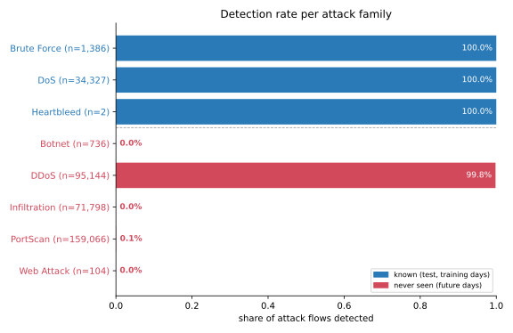
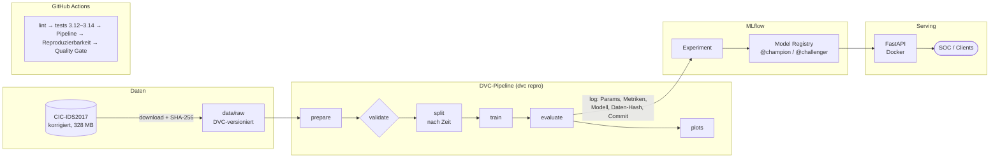

# Intrusion Detection MLOps

[](https://github.com/Maik-Huebner/intrusion-detection-mlops/actions/workflows/ci.yml)


> **TL;DR (English).** An end-to-end MLOps system that detects network attacks in flow data
> (corrected CIC-IDS2017, 2.1 M flows). The focus is the lifecycle around the model: versioned data,
> a validated and reproducible pipeline, experiment tracking with a model registry, a quality gate,
> a containerised scoring API and CI/CD. A time-based drift scenario shows why this matters:
> a model that is perfect on Monday–Wednesday catches only **29 %** of Thursday/Friday attacks,
> and retraining on Thursday lifts Friday from **37 %** to **99 %**.

Ein Machine-Learning-Modell erkennt im Netzwerkverkehr, ob eine Verbindung normal ist oder zu einem
Angriff gehört (DoS, Brute Force, PortScan, Botnet, Web-Angriffe …). Im Mittelpunkt steht aber
nicht das Modell, sondern der **Lebenszyklus drumherum**: Daten versionieren und prüfen,
reproduzierbar trainieren, Experimente vergleichen, nur geprüfte Modelle ausrollen und erkennen,
wann ein Modell veraltet ist.

## Das Ergebnis in einem Bild

Ein Modell, trainiert mit dem Verkehr von **Montag bis Mittwoch**, trifft auf **Donnerstag und Freitag**:



| | Erkennungsrate | Fehlalarmrate |
|---|---:|---:|
| Bekannte Angriffsarten (Testdaten Mo–Mi) | **100,0 %** (35.714 von 35.715) | 0 Fehlalarme |
| Neue Tage Do + Fr (ungesehene Angriffsarten) | **29,1 %** | 3 Fehlalarme bei 582.524 normalen Flows |

Offline sieht das Modell perfekt aus. Im Einsatz ist es gegen PortScan, Botnet, Infiltration und
Web-Angriffe fast vollständig blind. Nur DDoS erkennt es (99,8 %), weil es dem bekannten DoS ähnelt.
Das ist **Concept Drift**, und genau dafür braucht es MLOps: Nach dem Retraining mit den
Donnerstagsdaten steigt die Erkennung am Freitag von **37,3 % auf 99,1 %** (PortScan: 0,05 % → 99,2 %).
Botnet bleibt bei 1,9 %: Retraining hilft nur gegen Angriffe, die schon einmal gelabelt vorkamen.

## Warum MLOps gerade in der Cybersecurity?

Angreifer ändern ständig ihre Methoden. Ein Modell, das heute fast alle Angriffe findet, kann morgen
blind für eine neue Angriffsart sein, ohne dass sich an seinem Code etwas ändert. Ein einmal
trainiertes Modell reicht deshalb nicht. Man braucht eine Pipeline, die neue Daten aufnimmt,
prüft, neu trainiert, das neue Modell gegen das alte vergleicht und es nur dann sicher ausrollt,
wenn es wirklich besser ist.

## Architektur



| Baustein | Werkzeug | Was es hier leistet |
|---|---|---|
| Umgebung | **uv** + `uv.lock` | exakt gleiche Paketversionen lokal, in CI und im Docker-Image |
| Daten versionieren | **DVC** | Rohdaten und jeder Zwischenstand haben einen Hash. `dvc.lock` hält fest, welcher Datenstand welches Modell erzeugt hat |
| Datenqualität | `ids.pipeline.validate` | Schema, Wertebereiche, Labels. Eine Verletzung stoppt die Pipeline |
| Pipeline | **DVC** (`dvc.yaml`) | 6 Stufen, nur Geändertes wird neu gerechnet. Experimente mit `dvc exp` |
| Tracking & Registry | **MLflow** | Runs mit Parametern, Metriken, Berichten, Daten-Hash und Git-Commit. Champion/Challenger mit Rollback |
| Quality Gate | `ids.quality_gate` | Mindest-Erkennungsrate, maximale Fehlalarmrate, Mindest-F1. Sonst keine Freigabe |
| Serving | **FastAPI** + **Docker** | `/predict`, `/predict/batch`, Validierung jedes Merkmals, Modell aus Datei oder Registry |
| CI/CD | **GitHub Actions** | Lint, Tests auf drei Python-Versionen, komplette Pipeline auf den echten Daten, Reproduzierbarkeits-Check |

## Der Datensatz und warum die korrigierte Fassung

[CIC-IDS2017](https://www.unb.ca/cic/datasets/ids-2017.html) (Canadian Institute for Cybersecurity)
ist einer der meistgenutzten Benchmarks für Intrusion Detection: fünf Tage echter Netzwerkverkehr
(3.–7. Juli 2017) mit eingeschleusten Angriffen, aufbereitet als Flows mit über 80 Merkmalen.

Das Original hat **bekannte, schwerwiegende Fehler**: falsch gelabelte Angriffe, Fehler im
Feature-Extraktor CICFlowMeter, fehlerhaft zusammengesetzte Flows. Engelen et al. (2021) zeigen,
dass über 20 % der Flows neu erzeugt oder umgelabelt werden müssen. Viele Paper mit „99,9 %
Genauigkeit“ messen deshalb teilweise Artefakte statt Angriffe.

Dieses Projekt nutzt die **korrigierte Fassung von Liu, Engelen et al. (IEEE CNS 2022)**, die
Nachfolgerin der Korrektur von 2021, neu erzeugt aus den Original-PCAPs:

| Tag | Flows | davon Angriffe | Angriffsarten |
|---|---:|---:|---|
| Montag | 371.516 | 0 | nur normaler Verkehr |
| Dienstag | 321.963 | 6.933 | FTP-Patator, SSH-Patator (Brute Force) |
| Mittwoch | 496.527 | 171.642 | DoS Hulk, GoldenEye, Slowloris, Slowhttptest, Heartbleed |
| Donnerstag | 361.920 | 71.902 | Web-Angriffe (Brute Force, XSS, SQL Injection), Infiltration |
| Freitag | 547.452 | 254.946 | Botnet, PortScan, DDoS |

**Bewusste Entscheidungen in der Datenaufbereitung** (Details in [`prepare.py`](src/ids/pipeline/prepare.py)):

1. **„Attempted“-Flows werden normal.** 11.979 Flows gehören zu einem Angriffsskript, enthalten aber
   nichts Bösartiges (z. B. antwortet das Ziel nicht). Die Autoren empfehlen, sie als BENIGN zu werten.
2. **IP-Adressen, Ports der Quelle, Flow-ID und Zeitstempel fliegen raus.** Sonst lernt das Modell
   „172.16.0.1 greift an“ statt „so sieht ein Angriff aus“. Im echten Netz nützt das nichts.
3. **16-Bit-Überlauf in CICFlowMeter.** Die Validierung schlug beim ersten Lauf an: 593 Flows haben
   eine negative Header-Länge, alle zwischen −32.768 und 32.767. Lange Flows laufen in einem
   16-Bit-Zähler über. Der echte Wert ist nicht rekonstruierbar, die Zeilen (0,03 %) werden entfernt.
4. **Duplikate vor dem Split entfernen** (82.303 Flows). Sonst steht dieselbe Verbindung in Training
   und Test, und das Ergebnis sieht besser aus, als es ist.
5. **Split nach Zeit, nicht zufällig.** Ein Modell im Einsatz kennt nur die Vergangenheit.

## Schnellstart

Voraussetzungen: [uv](https://docs.astral.sh/uv/), Docker, ca. 3 GB freier Speicher.

```bash
git clone https://github.com/Maik-Huebner/intrusion-detection-mlops.git
cd intrusion-detection-mlops
uv sync                              # Umgebung exakt nach uv.lock
uv run python -m ids.data.download   # 328 MB, mit SHA-256-Prüfung
uv run dvc repro                     # komplette Pipeline (ca. 1 Minute auf einem M4 Pro)
uv run dvc metrics show              # Ergebnisse
```

`make help` zeigt alle Kurzbefehle (`make test`, `make lint`, `make pipeline`, `make gate` …).

### Modell tracken und registrieren

```bash
docker compose up -d mlflow                          # MLflow-Server auf http://localhost:5050
export MLFLOW_TRACKING_URI=http://localhost:5050
uv run python -m ids.registry log                    # Run + neue Modellversion
uv run python -m ids.registry promote                # Champion/Challenger-Entscheidung
uv run python -m ids.registry champion 1             # Rollback auf Version 1
```

### API starten

```bash
docker compose up -d --build api                     # http://localhost:8000/docs
curl -s localhost:8000/model
```

Die interaktive Doku unter `/docs` enthält als Beispiel einen echten SSH-Brute-Force-Flow aus dem
Testdatensatz.

## Projektstruktur

```
├── src/ids/                  Python-Paket
│   ├── schema.py             Datenvertrag: Merkmale, Labels, Angriffskategorien
│   ├── data/download.py      Rohdaten laden und per SHA-256 prüfen
│   ├── pipeline/             DVC-Stufen: prepare, validate, split, train, evaluate, plots
│   ├── metrics.py            SOC-Metriken: Erkennungsrate, Fehlalarmrate, …
│   ├── quality_gate.py       Freigabe-Kriterien
│   ├── registry.py           MLflow: Tracking, Registry, Champion/Challenger, Rollback
│   ├── lineage.py            Daten-Hash und Git-Commit für jedes Modell
│   └── api/                  FastAPI-App und Request/Response-Schemas
├── tests/                    Unit- und API-Tests (synthetische Daten, laufen in Sekunden)
├── docker/                   Dockerfiles für API und MLflow
├── reports/                  Berichte der Pipeline (versioniert, von CI geprüft)
├── dvc.yaml · params.yaml    Pipeline und Parameter
├── compose.yaml · Makefile
└── .github/workflows/ci.yml
```

## Qualität und Reproduzierbarkeit

- **Tests:** Unit-Tests für jede Datenregel, die Metriken, das Quality Gate und die API, mit
  synthetischen Daten im echten Schema. Sie brauchen den 328-MB-Datensatz nicht.
- **CI baut das Modell bei jedem Push neu aus den Rohdaten** und prüft mit `git diff --exit-code`,
  dass Metriken und Berichte Byte für Byte mit dem Commit übereinstimmen. Gegengeprüft unter
  Linux/amd64 (CI) und macOS/arm64 (Entwicklung).
- **Deterministisch:** feste Seeds, kein Early Stopping (es würde intern zufällig aufteilen),
  Metriken auf 4 Stellen gerundet, Diagramme als reines Vektor-SVG ohne Metadaten.

## Roadmap

- [ ] Monitoring: Data Drift mit Evidently, API-Metriken mit Prometheus und Grafana
- [ ] Automatisches Retraining, wenn Drift erkannt wird, mit Champion/Challenger-Freigabe
- [ ] Drift-Demo: Phase 1 (Mo–Mi) → Alarm am Donnerstag → Retraining → Phase 2 (Mo–Do)

## Quellen

- L. Liu, G. Engelen, T. Lynar, D. Essam, W. Joosen: *Error Prevalence in NIDS datasets: A Case Study
  on CIC-IDS-2017 and CSE-CIC-IDS-2018*. IEEE CNS 2022.
  [Datensatz und Dokumentation](https://intrusion-detection.distrinet-research.be/CNS2022/)
- G. Engelen, V. Rimmer, W. Joosen: *Troubleshooting an Intrusion Detection Dataset: the CICIDS2017
  Case Study*. IEEE SPW/WTMC 2021.
- I. Sharafaldin, A. H. Lashkari, A. A. Ghorbani: *Toward Generating a New Intrusion Detection Dataset
  and Intrusion Traffic Characterization*. ICISSP 2018.

Entstanden als Abschlussprojekt der Weiterbildung *AI Engineer* (IfaDW), Block „ML Apps Deployment“.
Code unter MIT-Lizenz. Für den Datensatz gelten die Bedingungen seiner Autoren.
